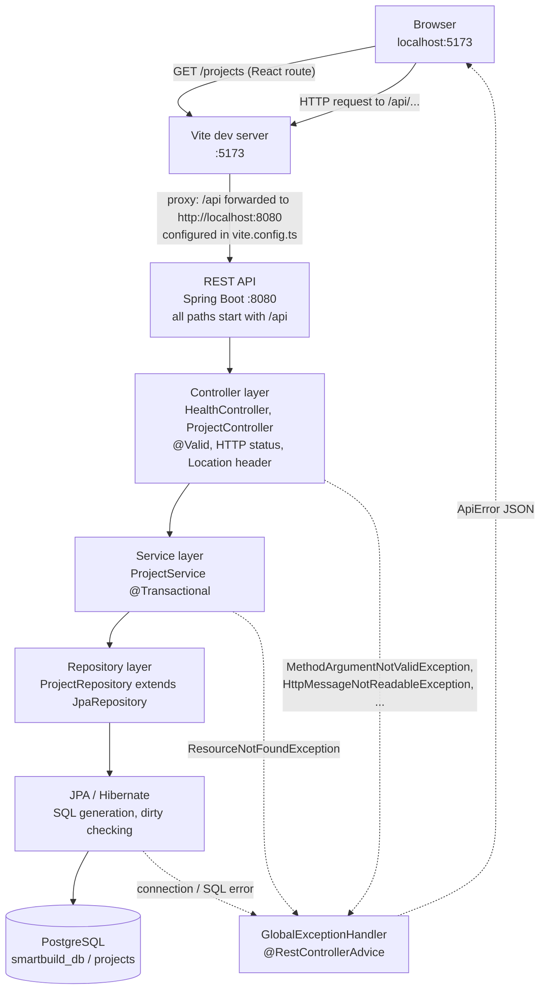
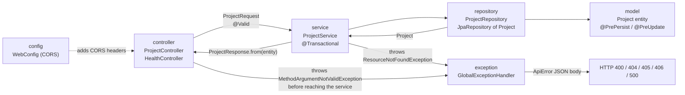
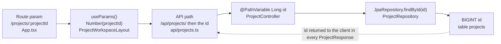

# Architecture — Base-v1

How a request travels through SmartBuild India Base-v1, who owns what, and where the
three future modules plug in.

Companion documents: [setup.md](setup.md) · [api-contract.md](api-contract.md) ·
[database.md](database.md) · [base-files.md](base-files.md) ·
[verification.md](verification.md) · [root README](../README.md)

---

## Request flow

Notes that matter in practice:

- In development the browser only ever talks to **one origin** (`localhost:5173`).
  The Vite proxy forwards `/api` to `localhost:8080`, so CORS is not involved at all.
  CORS only appears if you point the frontend at an absolute API URL — see
  [setup.md §10](setup.md#10-troubleshooting).
- `open-in-view: false` (in `application.yml`) means the JPA session is closed when the
  controller returns; every read must happen inside the service transaction.

## Backend package flow

Package map (frozen — `com.smartbuild`):

Frozen = the seven existing packages and the `com.smartbuild` root stay exactly as they
are. Each member adds NEW sub-packages under `com.smartbuild` (for example
`com.smartbuild.plan`) and may add their own DTO records to `com.smartbuild.dto`. Never
add a class to another member's package.

| Package | Contains | Role |
|---|---|---|
| `config` | `WebConfig` | CORS for `/api/**` from `app.cors.allowed-origins` |
| `controller` | `HealthController`, `ProjectController` | HTTP mapping only; no business logic |
| `dto` | `ProjectRequest`, `ProjectResponse`, `ApiError` | The JSON contract in both directions |
| `model` | `Project`, `ProjectStatus` | JPA entity + enum |
| `repository` | `ProjectRepository` | `JpaRepository<Project, Long>`, no custom queries |
| `service` | `ProjectService` | All business operations and transactions; entity↔DTO mapping itself lives in the `ProjectResponse.from(entity)` static factory |
| `exception` | `ResourceNotFoundException`, `GlobalExceptionHandler` | Turns every failure into an `ApiError` (or an empty 406/500 body when the client will not accept JSON) |

---

## Layer responsibilities

| Layer | Owns | Does not own |
|---|---|---|
| **Frontend** (`frontend/src`) | Routing, layout, forms, rendering API data, UX-level checks (required fields, `> 0`, whole numbers), loading/empty/error states, type definitions in `types/project.ts`, the workspace module list in `types/workspace.ts` | Business rules, calculations, authoritative validation, persistence |
| **Backend** (`backend/src`) | Endpoint behaviour, bean validation (`@NotBlank`, `@Size`, `@Positive`, `@Digits`, `@Min`/`@Max`…), create/update/delete semantics, status defaults, sorting, error codes, transactions | HTML/CSS, browser state, user-facing wording of errors beyond `message` |
| **Database** (`smartbuild_db`) | Storage, column types and lengths (`VARCHAR(150)`, `NUMERIC(12,2)`), `NOT NULL`, primary key generation (identity), enum check constraint, `timestamp(6) with time zone` precision | Any business rule beyond constraints; there are no triggers, views or stored procedures |

The frontend calls five functions in `frontend/src/api/projects.ts`, and every one of
them maps to a documented endpoint in [api-contract.md](api-contract.md).

---

## Why the frontend has no business calculations

**One source of truth.** A project's areas, floors, budget and status live in one row
of `projects` and are described by one contract (`ProjectResponse`). If the UI
recomputed anything — say a derived area or a status transition — two clients (browser
and curl) could disagree about the same project, and a second consumer added later
would have to reimplement the rule.

**The backend validates and calculates.** Every constraint in Base-v1 is enforced on
the server with bean validation on `ProjectRequest` (`@NotBlank`, `@Size`, `@Positive`,
`@Min(1)`, `@Max(200)`, `@PositiveOrZero`, `@Digits`) and re-checked by the database
(`NOT NULL`, `NUMERIC` precision, the enum check constraint). The service decides the semantics:
`null` status means `DRAFT` on create and "keep the existing value" on update; `null`
budget means "no budget" on create and "clear it" on update. None of that lives in the
browser, so `curl` gets exactly the same behaviour as the UI.

**The frontend only renders, plus UX-level checks.** `CreateProjectPage.tsx` does run
`validate()` before submitting — that is deliberate UX: instant feedback, no round
trip, nicer wording than `"must be between 2 and 150 characters"`. It is **not**
authoritative. The page still sends whatever passes and renders `fieldErrors` returned
by the API, so a client that skips the JS validation hits the same rules.

Rule of thumb for every member: *if a number can be wrong, the backend must be able to
reject it.* The UI may additionally check it to be kind.

---

## Project ID as the common identity

`ProjectResponse.id` (a Java `Long`, JSON `number`, PostgreSQL `BIGINT` identity) is the
join key for the whole product. Every future entity — floor plan, analysis result,
estimate line, 3D scene, report — will reference `projects.id`.

The id never changes meaning as it moves through the stack:

Concretely, in Base-v1:

1. The user opens `/projects/42/overview`. React Router exposes `projectId = "42"`.
2. `ProjectWorkspaceLayout` converts it with `Number(...)` and calls
   `getProject(42)` → `GET /api/projects/42`.
3. `ProjectController.update/getById/delete` receive `@PathVariable Long id`.
4. `ProjectService.getById(id)` (returns `ProjectResponse`, throws
   `ResourceNotFoundException("Project not found with id 42")`) — or, from your own
   service, `ProjectRepository.findById`.
5. The response carries `"id": 42`, and the layout passes the whole
   `ProjectResponse` to every child page through the router outlet context
   (`<Outlet context={{ project }} />`), so no page re-fetches it.

Rules that follow from this:

- **Never drop `projectId` from a URL.** `ProjectWorkspaceLayout` builds every nav link
  as `/projects/${projectId}/${segment}`; a new tab must be nested under the existing
  `/projects/:projectId` route. Both the route and the nav entry now come from a single
  list — `WORKSPACE_MODULES` in `frontend/src/types/workspace.ts` (see
  [base-files.md](base-files.md#workspace-ts)),
  so a tab can never exist in one place and be missing from another.
- **Never reuse an id field for anything else.** New tables get their own `id` column
  plus an explicit `project_id` foreign key.
- Client-supplied ids are ignored: `id` and the timestamps are not part of
  `ProjectRequest` and cannot be set from outside.

---

## How Members 2, 3 and 4 attach later

Every item in this table is **FUTURE — not implemented in Base-v1**.

| Member | New backend packages/controllers (**FUTURE — not implemented in Base-v1**) | New frontend routes (**FUTURE — not implemented in Base-v1**) | New entities (**FUTURE — not implemented in Base-v1**) |
|---|---|---|---|
| **2 — Plans / AI Analysis** | `com.smartbuild.plan` (controller + service + repository), `com.smartbuild.analysis`, mounted under `/api/projects/{projectId}/plans` and `/api/projects/{projectId}/analysis` | `/projects/:projectId/plans`, `/projects/:projectId/analysis` — real entries declared in `types/workspace.ts`, element swapped in `App.tsx` | `FloorPlan` (file metadata, FK → `projects.id`), `PlanAnalysis` (model output, FK → `floor_plan.id` and/or `projects.id`) |
| **3 — Estimation / Materials / Labour** | `com.smartbuild.estimation`, `com.smartbuild.material`, `com.smartbuild.labour`, mounted under `/api/projects/{projectId}/estimation`, `/api/projects/{projectId}/materials`, `/api/projects/{projectId}/labour` | `/projects/:projectId/estimation`, `/projects/:projectId/materials`, `/projects/:projectId/labour` — flip the `placeholder` flags in `types/workspace.ts` | `Estimate`, `MaterialLine`, `LabourLine` — all FK → `projects.id`; read `Project` areas/floors/budget through `ProjectRepository` |
| **4 — 3D / Reports** | `com.smartbuild.visualization` and `com.smartbuild.report` mounted at `/api/projects/{projectId}/3d` and `/api/projects/{projectId}/reports` | `/projects/:projectId/3d`, `/projects/:projectId/reports` — flip the `placeholder` flags in `types/workspace.ts` | `Report` (FK → `projects.id`) plus whatever Member 4 consumes from Member 2/3 output tables |

How to attach (the same recipe for all three, spelled out in
[base-files.md](base-files.md#the-three-where-do-i-add-my-module-recipes)):

1. Add the entity + repository in a **new** package. Do not widen `Project` with
   module-specific columns.
2. Add a controller under `/api/...` that takes `projectId` from the path and loads the
   project with `ProjectRepository.findById` first (404 if missing — reuse
   `ResourceNotFoundException` and `GlobalExceptionHandler`).
3. Declare the module in `WORKSPACE_MODULES` in `frontend/src/types/workspace.ts` —
   that one entry creates the route (from `App.tsx`), the sidebar link and the overview
   card. Set `placeholder: false` and swap the `ModulePlaceholderPage` element in
   `App.tsx` for the real page, keeping it under the `/projects/:projectId` branch.
4. Add new endpoint types to `frontend/src/api/` and new response types next to
   `types/project.ts` — never change `ProjectResponse` fields.

If the Members 2/3 tables do not exist yet, build the dashboard from `Project` alone
and guard report queries so they render an empty state instead of a 500.

Constraints shared by all members (also stated in the root README): existing API paths
and `ProjectResponse` field names do not change; business validation lives in the
backend; the frontend never duplicates calculation logic.

---

## Deliberately excluded from Base-v1

| Excluded | Why |
|---|---|
| Microservices | One deployable jar is easier to run and debug; splitting adds network failure modes with no benefit at this scale. |
| Kafka / any message broker | Every operation here is a synchronous request/response; there is no asynchronous work to stream. |
| CQRS | Reads and writes share one small model; separate models would double the code for no load to justify it. |
| Event sourcing | `projects` has no audit/history requirement yet; a current-state row is simpler and sufficient. |
| Caching (Redis / second-level cache) | The database is local and the data is small; a cache would introduce invalidation bugs without a measured need. |
| Pagination | `GET /api/projects` returns every project; at student-project scale the list stays small (documented limitation in the README). |
| Soft deletes | `DELETE` is a hard row delete; recovery would need a trash concept the product does not have yet. |
| Migrations (Flyway / Liquibase) | Base-v1 uses `ddl-auto=update` for local development only — this is a known shortcut, and [database.md](database.md#schema-management) states exactly what must change before production. |
| Authentication / users | There is no notion of ownership yet; adding login would invent a model (roles, sessions) that no current feature uses. |
| Lombok / MapStruct / Redux / React Query / Tailwind | Explicit, dependency-light code: records, a static `ProjectResponse.from` factory, `useState`/`useEffect`, hand-written CSS with tokens. Fewer moving parts to learn and to break. |
| File storage | Nothing uploads a file in Base-v1, so there is no upload directory or object store to configure. |
