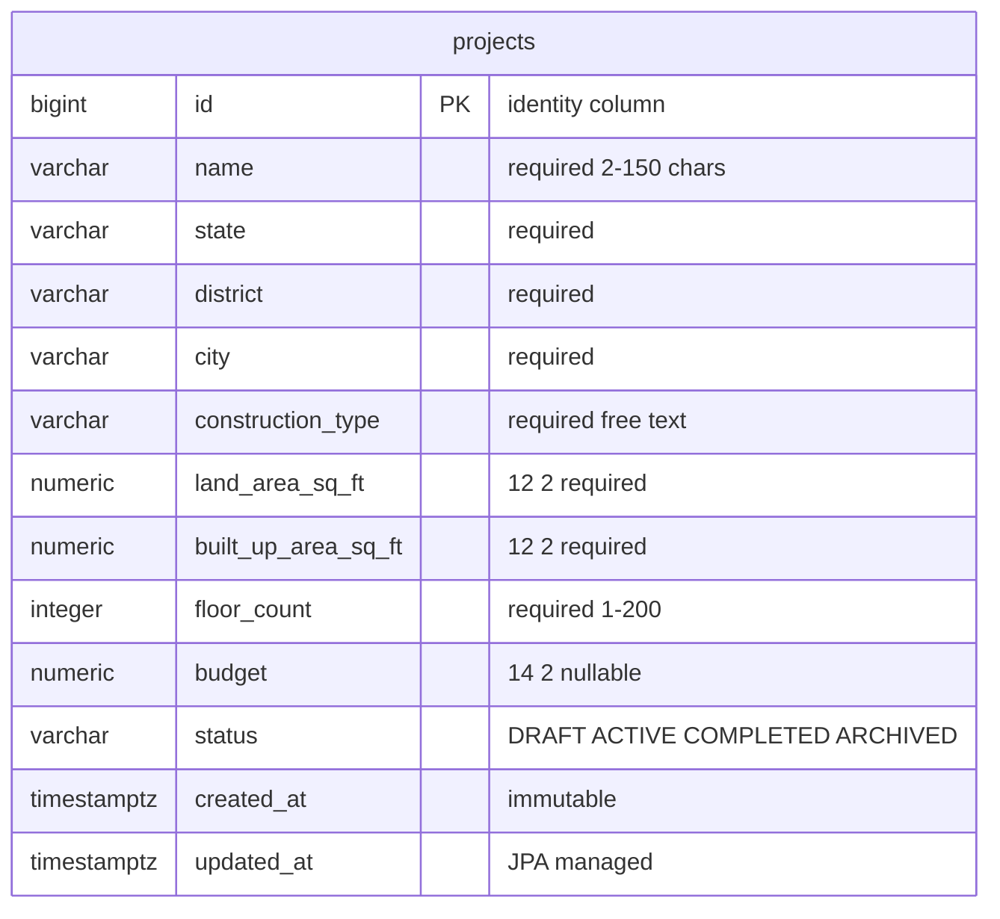

# Database — `smartbuild_db`

| | |
|---|---|
| Database name | `smartbuild_db` |
| Engine | PostgreSQL (16 verified; README requires 14+) |
| Driver | `org.postgresql:postgresql` (declared in `backend/pom.xml`, version managed by the Spring Boot parent) |
| JDBC URL | `jdbc:postgresql://localhost:5432/smartbuild_db` (`DB_URL`) |
| Role (default) | `smartbuild` (`DB_USERNAME`); password comes only from `DB_PASSWORD` |
| Tables in Base-v1 | **one**: `projects` |
| Access path | Hibernate / JPA via `ProjectRepository`; no hand-written SQL anywhere |

Setup instructions (creating the database, role and grants): [setup.md §3](setup.md#3-create-the-postgresql-database).

---

## The `projects` table

Derived from `backend/src/main/java/com/smartbuild/model/Project.java` and confirmed
against a live `psql '\d projects'` on the verification database.

| Column | SQL type | Nullable | Meaning |
|---|---|---|---|
| `id` | `bigint` — identity, PK | no | Surrogate primary key, generated by the database (`generated by default as identity`). Never sent by a client. |
| `name` | `varchar(150)` | no | Project name. UI and API require 2–150 characters. |
| `state` | `varchar(100)` | no | Indian state of the site (e.g. `Karnataka`). |
| `district` | `varchar(100)` | no | District within the state. |
| `city` | `varchar(100)` | no | City / town of the site. |
| `construction_type` | `varchar(100)` | no | Free text on the API side (`Residential`, `Commercial`, `Industrial`, `Institutional`, `Mixed Use`, `Other` in the UI). |
| `land_area_sq_ft` | `numeric(12,2)` | no | Plot area in square feet. Max `9999999999.99`. |
| `built_up_area_sq_ft` | `numeric(12,2)` | no | Built-up area in square feet. Max `9999999999.99`. |
| `floor_count` | `integer` | no | Number of floors; API enforces 1–200. |
| `budget` | `numeric(14,2)` | **yes** | Budget in INR. Max `999999999999.99`. `NULL` = not decided. |
| `status` | `varchar(20)` | no | Lifecycle state; see [Enum section](#status-enum). |
| `created_at` | `timestamp(6) with time zone` | no | Insert time (UTC). Immutable — see [Lifecycle fields](#lifecycle-fields). |
| `updated_at` | `timestamp(6) with time zone` | no | Last update time (UTC). |

Physical extras that Hibernate generated (verbatim from `\d projects`):

```text
Indexes:
    "projects_pkey" PRIMARY KEY, btree (id)
Check constraints:
    "projects_status_check" CHECK (status::text = ANY (ARRAY['DRAFT'::character varying, 'ACTIVE'::character varying, 'COMPLETED'::character varying, 'ARCHIVED'::character varying]::text[]))
```

Live `psql -c '\d projects'` output, for reference (the header and the trailing
`Indexes` / `Check constraints` blocks are part of the real output):

```text
                                           Table "public.projects"
       Column        |            Type             | Collation | Nullable |             Default
---------------------+-----------------------------+-----------+----------+----------------------------------
 id                  | bigint                      |           | not null | generated by default as identity
 budget              | numeric(14,2)               |           |          |
 built_up_area_sq_ft | numeric(12,2)               |           | not null |
 city                | character varying(100)      |           | not null |
 construction_type   | character varying(100)      |           | not null |
 created_at          | timestamp(6) with time zone |           | not null |
 district            | character varying(100)      |           | not null |
 floor_count         | integer                     |           | not null |
 land_area_sq_ft     | numeric(12,2)               |           | not null |
 name                | character varying(150)      |           | not null |
 state               | character varying(100)      |           | not null |
 status              | character varying(20)       |           | not null |
 updated_at          | timestamp(6) with time zone |           | not null |
Indexes:
    "projects_pkey" PRIMARY KEY, btree (id)
Check constraints:
    "projects_status_check" CHECK (status::text = ANY (ARRAY['DRAFT'::character varying, 'ACTIVE'::character varying, 'COMPLETED'::character varying, 'ARCHIVED'::character varying]::text[]))
```

Notes:

- **Money and areas are `numeric`, never `float`/`double`.** The entity uses
  `BigDecimal` end to end so `4500000.00` stays exact.
- **`status` has no column default in PostgreSQL.** The `DRAFT` default comes from the
  Java field initializer (`private ProjectStatus status = ProjectStatus.DRAFT;`) plus
  `ProjectService` leaving a null request status untouched. A hand-written
  `INSERT ... (columns) VALUES (...)` that omits `status` fails with a not-null
  violation — include it explicitly when writing raw SQL.
- The `id` default is `generated by default as identity`, not `always as identity`, so
  an explicit id *could* be inserted — but the API never accepts one.

---

## Lifecycle fields

`created_at` and `updated_at` are written by **JPA lifecycle callbacks on the entity**,
not by the database, not by Spring Data auditing, and not by the client.

```java
// backend/src/main/java/com/smartbuild/model/Project.java
@PrePersist
void onCreate() {
    Instant now = Instant.now();
    createdAt = now;
    updatedAt = now;
}

@PreUpdate
void onUpdate() {
    updatedAt = Instant.now();
}
```

| Field | Set on insert | Set on update | Column flags |
|---|---|---|---|
| `created_at` | yes (`@PrePersist`) | **no** | `@Column(name = "created_at", nullable = false, updatable = false)` |
| `updated_at` | yes (`@PrePersist`) | yes (`@PreUpdate`) | `@Column(name = "updated_at", nullable = false)` |

Consequences you can rely on:

- `updatable = false` on `created_at` means Hibernate will never put `created_at` in an
  `UPDATE` statement, so a row's creation time survives every `PUT`. This was observed
  live: after an update, `createdAt` was unchanged while `updatedAt` moved.
- Clients cannot set either field. `ProjectRequest` has no `createdAt`/`updatedAt`
  components, so Jackson never binds them; `ProjectResponse.from(entity)` is the only
  path that produces them.
- There are **no** `ON UPDATE CURRENT_TIMESTAMP` clauses and no triggers — if you write
  to the table with raw SQL, you must set `updated_at` yourself.
- **The `updatedAt` inside a `PUT` response can lag the database.** The response is built
  from the entity while it still holds the old timestamp; `@PreUpdate` runs when the
  changes are flushed at commit, afterwards. Captured twice on the same instance: a `PUT`
  returned `21:16:42.057588Z` while the row read back `21:17:00.538033Z`, and the next
  `PUT` returned that `21:17:00.538033Z` while the row advanced to
  `21:17:38.829927Z`. The database is right, the JSON is one step behind, and the next
  `GET` shows the committed value. `created_at` does not have this problem, because
  `generated by default as identity` forces the insert (and the `@PrePersist` timestamp)
  to happen before the response is built. See
  [api-contract.md § PUT](api-contract.md#put).
- `Instant` is UTC. PostgreSQL stores `timestamp with time zone`; the API serialises
  ISO-8601 with a `Z` suffix. Display localisation happens in the browser
  (`Intl.DateTimeFormat('en-IN', ...)` in the pages).

---

## `status` enum

Stored as a plain `VARCHAR(20)` holding the **enum constant name**, via
`@Enumerated(EnumType.STRING)` on `ProjectStatus`:

| Value | Meaning (as used by Base-v1) |
|---|---|
| `DRAFT` | Default for new projects. |
| `ACTIVE` | In progress. |
| `COMPLETED` | Finished. |
| `ARCHIVED` | Kept but inactive. |

- Java enum: `backend/src/main/java/com/smartbuild/model/ProjectStatus.java` — exactly
  these four constants, in this order.
- Because `EnumType.STRING` is used, renaming a constant in Java **breaks** existing
  rows (and vice versa); the check constraint `projects_status_check` would reject old
  values after a rename.
- Default `DRAFT` is application-side only (see the note above).
- The API accepts `status` as a JSON string; an unknown value such as `"BOGUS"` is a
  deserialization failure and returns `400 BAD_REQUEST` with
  `"Malformed request body"` — see [api-contract.md](api-contract.md#apierror).

---

## ER diagram

One entity, because Base-v1 has exactly one table. No other table exists — do not infer
any.



(timestamptz is shorthand for the real type `timestamp(6) with time zone`.)

**FUTURE — not implemented in Base-v1:** the other members will add tables such as
`floor_plans`, `plan_analyses`, `estimates`, `material_lines`, `labour_lines` and
`reports`, each with a `project_id` column referencing `projects.id`. None of them exist
today; see [architecture.md](architecture.md#how-members-2-3-and-4-attach-later).

---

## Schema management

**This is the honest description — Base-v1 has no migration tool.**

- Schema is produced by Hibernate at application startup from the JPA entities:
  `spring.jpa.hibernate.ddl-auto=${DB_DDL_AUTO:update}` in
  `backend/src/main/resources/application.yml`.
- `update` means: create `projects` if it is missing, and `ALTER TABLE` it to add
  columns/constraints that the entities declare but the table lacks.
- There is **no Flyway** and **no Liquibase** — neither is on the classpath
  (`backend/pom.xml` has five dependencies: `spring-boot-starter-web`,
  `spring-boot-starter-data-jpa`, `spring-boot-starter-validation`, `postgresql`,
  `spring-boot-starter-test`). There is no `src/main/resources/db/migration` directory.
- There are no hand-written SQL scripts in the repository.

**What that means in practice:**

- Fine for local development and for this milestone: the entities are the single
  description of the schema, everyone gets the same table by running the app, and there
  is no migration tooling to learn or to break.
- **Not acceptable once real data matters.** `update` can only add/alter a subset of
  changes; it never drops or renames, it cannot roll back, it cannot merge two
  developers' divergent edits, and a careless entity change can silently alter a table
  holding someone's work.

**What must change before production (and who should do it):**

1. One team member (whoever owns the database — currently unassigned; claim it before
   the first shared data exists) introduces **Flyway** (or Liquibase): add the
   dependency, create `src/main/resources/db/migration/V1__create_projects.sql`
   describing exactly the table above, and add an `V2__...` file for every subsequent
   change.
2. The same person switches `DB_DDL_AUTO` default from `update` to **`validate`**, so
   Hibernate only checks that the entities and the migrated schema agree — it stops
   writing DDL entirely.
3. The team agrees that schema changes are always a new migration file, never an entity
   edit alone.

Until step 1 happens, treat the table as disposable: **do not put data you cannot
recreate into it.**

---

## Manual SQL (no application required)

Useful if you want the database ready before the first backend start, or if you are
debugging with `psql` directly. Run as a superuser.

**Step 1 — role and database** (substitute your own password):

```sql
CREATE ROLE smartbuild LOGIN PASSWORD 'SUBSTITUTE_YOUR_OWN_PASSWORD';
CREATE DATABASE smartbuild_db OWNER smartbuild;
```

If you cannot use `OWNER`, use the `GRANT`-only variant — on PostgreSQL 15+ you must
grant the schema too:

```sql
CREATE DATABASE smartbuild_db;
CREATE ROLE smartbuild LOGIN PASSWORD 'SUBSTITUTE_YOUR_OWN_PASSWORD';
GRANT ALL PRIVILEGES ON DATABASE smartbuild_db TO smartbuild;
\c smartbuild_db
GRANT ALL ON SCHEMA public TO smartbuild;
```

Why the second grant: since PostgreSQL 15, `PUBLIC` no longer has `CREATE` on the
`public` schema, so `CREATE TABLE` fails with `permission denied for schema public`
until it is granted. The full explanation, and the reproduction on PostgreSQL 16, are in
[setup.md §3b](setup.md#3b-alternative-grant-only-path-read-this-before-copying-the-readmes-three-line-version).

**No `ALTER DEFAULT PRIVILEGES` is required** in this flow: the application connects as
`smartbuild`, and with `ddl-auto=update` it creates `projects` itself, so it owns the
table. Add default-privilege grants only when a *different* role will create the objects
(for example a DBA running Step 2 below by hand):

```sql
-- run as the role that will CREATE the objects, inside smartbuild_db
ALTER DEFAULT PRIVILEGES IN SCHEMA public GRANT ALL ON TABLES TO smartbuild;
ALTER DEFAULT PRIVILEGES IN SCHEMA public GRANT ALL ON SEQUENCES TO smartbuild;
```

Without those two statements, a `projects` table created by `postgres` stays invisible
to `smartbuild` (each object's `GRANT` is separate from the schema grant).

**Step 2 — table** (column-for-column the schema Hibernate created in the verification
database; run inside `smartbuild_db`):

```sql
CREATE TABLE projects (
    id                   bigint GENERATED BY DEFAULT AS IDENTITY PRIMARY KEY,
    name                 varchar(150)  NOT NULL,
    state                varchar(100)  NOT NULL,
    district             varchar(100)  NOT NULL,
    city                 varchar(100)  NOT NULL,
    construction_type    varchar(100)  NOT NULL,
    land_area_sq_ft      numeric(12,2) NOT NULL,
    built_up_area_sq_ft  numeric(12,2) NOT NULL,
    floor_count          integer       NOT NULL,
    budget               numeric(14,2),
    status               varchar(20)   NOT NULL,
    created_at           timestamp(6) with time zone NOT NULL,
    updated_at           timestamp(6) with time zone NOT NULL,
    CONSTRAINT projects_status_check
        CHECK (status IN ('DRAFT', 'ACTIVE', 'COMPLETED', 'ARCHIVED'))
);
```

Deliberately **absent** from that DDL, exactly as Hibernate leaves it:

- no `DEFAULT` on `status` (the `DRAFT` default is Java-side — see the notes above), so
  raw `INSERT`s must supply it;
- no `CHECK (land_area_sq_ft > 0)` / `floor_count` range / `budget >= 0` — those rules
  are bean validation in `ProjectRequest`, which runs in the application, not in the
  database. The only data constraint the database itself adds is the enum check.

Hand-written sample row:

```sql
INSERT INTO projects (name, state, district, city, construction_type,
                      land_area_sq_ft, built_up_area_sq_ft, floor_count,
                      budget, status, created_at, updated_at)
VALUES ('Greenfield Villa', 'Karnataka', 'Bengaluru Urban', 'Bengaluru', 'Residential',
        2400.00, 1800.50, 2, 4500000.00, 'DRAFT',
        now(), now());

SELECT id, name, status, budget, created_at FROM projects ORDER BY created_at DESC;
```

Check what Hibernate actually created (the authoritative answer):

```bash
docker exec -it smartbuild-pg psql -U smartbuild -d smartbuild_db -c '\d projects'
```

(Adjust the user/container names to yours; on a native install use
`psql -U smartbuild -d smartbuild_db -c '\d projects'`.)

If you create the table by hand first, the next backend start with `ddl-auto=update`
compares it against the entities and adds anything missing (it never drops or renames);
constraint names Hibernate wants may differ in wording from yours, which is harmless but
visible in `\d projects`.

See also: [setup.md](setup.md) for running the stack,
[verification.md](verification.md) for the checks that were actually executed.
